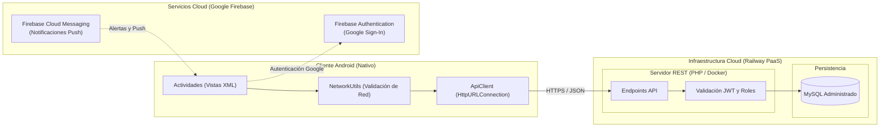

# Boletín Digital Escolar - App Android (TP2)

  
  
  
  
  
  
  
  

## 1. Presentación

**App:** Boletín Digital Escolar (Android, Java).

**Tema:** Versión nativa Android del Portal Académico y Boletín Digital: permite a tutores y estudiantes consultar el boletín oficial, asistencia y materias previas/mesas de examen, y a preceptores/docentes gestionar el padrón de alumnos, cargar calificaciones y asistencia, y publicar avisos institucionales. Está adaptada a dos jurisdicciones con normativas distintas: Formosa (trimestral) y Buenos Aires (cuatrimestral, R.I.T.E.).

**Integrantes (Grupo 15 - Boletín Escolar):**
* Monleón Lucrecia
* Almazan Alejandro
* Peña Yamila Gisele
* Camila Mailen Rodriguez
* Julieta Cuchan

**🎥 Video Demostración en Google Drive:**  
[Ver Video Demostrativo del Grupo 15](https://drive.google.com/file/d/1Qm6OX5YIiT-4JFNP7DGDwsKH_K96lMIi/view?usp=sharing)  
Demostración completa en video de la app en funcionamiento real, recorriendo el portal de estudiantes y familias (Formosa y PBA) y la suite de gestión de preceptoría.

**🌐 Demo Web en vivo (Portal del TP1):**  
<https://boletin-digital-escolar-production.up.railway.app>  
Permite acceder y probar el portal escolar desde el navegador para comparar la sincronización en vivo con la app Android.

**🔌 URL de la API REST (Backend en Railway):**  
`https://boletin-digital-escolar-production.up.railway.app/api/`  
Desplegada en **Railway** (alojando la API PHP y la base de datos MySQL). Es el mismo backend que consumen tanto el portal web como esta app Android del TP2.

---

## 2. Arquitectura del Sistema

**Flujo de comunicación entre componentes:**
* **Capa Cliente (Android):** El usuario interactúa con las actividades nativas. Ante cada solicitud de datos, `NetworkUtils` comprueba la conectividad del dispositivo (Wi-Fi/datos móviles). Si hay red, `ApiClient` ejecuta peticiones asíncronas vía HTTPS enviando el token JWT.
* **Capa Cloud (Google Firebase):** 
  * **Firebase Authentication:** Gestiona la validación de cuentas Google para el acceso directo de tutores en la nube.
  * **Firebase Cloud Messaging (FCM):** Canal de mensajería en la nube para recepción de avisos y alertas escolares (`BoletinFirebaseMessagingService`).
* **Infraestructura Cloud (Railway):** Aloja en un mismo entorno PaaS tanto el **Servidor REST** (contenedor Docker con PHP 8.2 que valida tokens JWT y ejecuta la lógica según la jurisdicción) como la **Base de Datos MySQL administrada**, donde residen estudiantes, calificaciones, asistencias, materias previas y mesas de examen.

---

## 3. Cómo correrla

### Requisitos
* Android Studio (Ladybug o superior) con un emulador o dispositivo con **Android 7.1 (API 25)** o superior, y conexión a Internet.
* Una cuenta y proyecto de **Firebase** propios (ver más abajo), porque el archivo de configuración real no está en el repositorio.

### Paso a paso
1. **Clonar el repositorio** y abrirlo en Android Studio como proyecto existente (`File > Open`).
2. **Configurar Firebase:**
   * Entrá a la [consola de Firebase](https://console.firebase.google.com/), creá (o usá) un proyecto y agregale una app Android con el `package name` `com.example.boletindigital`.
   * Cargá el **SHA-1** de tu keystore de debug (necesario para que funcione el inicio de sesión con Google) — se obtiene con `./gradlew signingReport`.
   * Descargá el `google-services.json` real que te da Firebase y copialo dentro de `app/` (reemplazando o junto a `app/google-services.json.example`, que es solo la plantilla sin datos reales — ver [R7 / Limitaciones](#8-limitaciones-conocidas) y el `.gitignore`).
   * Habilitá en **Authentication** el proveedor **Google** y dejá activo **Cloud Messaging** en la consola de Firebase.
3. **Sincronizar Gradle** (`File > Sync Project with Gradle Files`) y compilar (`Build > Make Project`).
4. **Ejecutar** la app (`Run > Run 'app'`) en un emulador o dispositivo físico. La URL base de la API ya está fijada en el código (ver sección 7), no hace falta configurarla.
5. **Generar el APK de depuración** para entregar: `Build > Build Bundle(s) / APK(s) > Build APK(s)`, o por terminal: `./gradlew assembleDebug`. El archivo queda en `app/build/outputs/apk/debug/app-debug.apk`.

### Usuarios de prueba (datos reales del backend desplegado)
| Rol | Método de Ingreso | Usuario / Correo | Contraseña / Clave | Escuela / Lo que reconoce |
|---|---|---|---|---|
| **Alumno** | Solo DNI + Clave | `48763736` | `3736` | Uriel Luciano Pleininger (E.E.S. N° 5 - Buenos Aires / R.I.T.E.) |
| **Alumno** | Solo DNI + Clave | `34567890` | `7890` | Mateo Gómez (EPES N° 19 - Formosa / Trimestral) |
| **Tutor** | Correo + Clave | `pedro@gmail.com` | `tutor123` | Reconoce como hijo a Mateo Gómez (Formosa) |
| **Tutor** | Correo + Clave | `cristian@gmail.com` | `tutor123` | Reconoce como hijo a Uriel Pleininger (PBA) |
| **Tutor con Google** | Google Sign-In | Cualquier cuenta de Gmail | (Botón de Google) | Ingresa como Tutor familiar en la nube (**Firebase Auth**) |
| **Preceptor / Docente** | Correo + Clave | `preceptor@escuela.edu.ar` | `admin123` | Panel general de gestión escolar completo |

---

## 4. Pantallas de la app (R1)

| Pantalla (Activity) | Qué hace |
|---|---|
| `MainActivity` | Inicio de sesión (credenciales, DNI + clave, o Google/Firebase Auth); selector de rol Tutor/Alumno vs Preceptor/Docente. |
| `MenuPrincipalActivity` | Panel central: accesos directos según el rol logueado (dashboard de gestión). |
| `AlumnosActivity` | Listado y búsqueda del padrón de alumnos, con acciones de editar/eliminar para Preceptor. |
| `DetalleAlumnoActivity` | Detalle completo de un alumno puntual (abre por su id, recibido por extra). |
| `NuevoAlumnoActivity` | Alta o edición de un alumno del padrón (formulario con validaciones). |
| `ConfirmarAlumnoActivity` | Pantalla de confirmación tras registrar/editar un alumno. |
| `CargarNotasActivity` | Carga de calificaciones por planilla (Docente/Preceptor), con alta/baja de notas. |
| `InstitucionActivity` | Gestión institucional: datos de escuelas y sedes. |
| `BoletinAlumnoActivity` | Portal del Tutor/Alumno: boletín oficial, asistencia y previas en un solo lugar. |
| `PreviasMesasActivity` | Previas y mesas de examen desde la vista del Tutor/Alumno. |
| `AsistenciaAvisosActivity` | Asistencia y avisos institucionales desde la vista del Tutor/Alumno. |
| `CargarAsistenciaActivity` | Carga de asistencia escolar (Preceptor/Docente). |
| `GestionAvisosActivity` | Publicación y gestión de avisos institucionales (Preceptor/Docente). |
| `GestionMesasActivity` | Alta, edición, inscripción y baja de mesas de examen (Preceptor/Docente). |
| `GestionPreviasActivity` | Gestión de materias previas por alumno (Preceptor/Docente). |
| `PerfilDocenteActivity` | Perfil del usuario Preceptor/Docente logueado. |

Navegación por `Intent` + `putExtra`/`getStringExtra` entre todas las pantallas (por ejemplo `token`, `rol`, `nombre`, `id_alumno`); `DetalleAlumnoActivity` abre un alumno puntual a partir del id recibido por extra, cumpliendo el requisito de abrir un elemento por su id.

---

## 5. Endpoints de la API que usa la app (R2)

Todos se consumen por HTTPS desde `ApiClient.java`, con `HttpURLConnection` fuera del hilo principal (`ExecutorService`).

| Método | Endpoint | Para qué lo usa la app |
|---|---|---|
| `POST` | `auth.php` | Iniciar sesión (credenciales, DNI+clave, Google o accesos demo). |
| `GET` | `auth.php` | Validar el token de sesión activo. |
| `GET` | `alumnos.php` | Listar el padrón de alumnos (todos o filtrado por institución), o consultar uno por `id`. |
| `POST` | `alumnos.php` | Registrar un nuevo alumno. |
| `PUT` | `alumnos.php?id=` | Modificar los datos de un alumno existente. |
| `DELETE` | `alumnos.php?id=` | Eliminar un alumno del padrón. |
| `GET` | `boletin.php?dni=` | Consultar el boletín académico oficial de un alumno. |
| `GET` / `POST` / `DELETE` | `notas.php` | Listar, guardar en lote y eliminar calificaciones. |
| `GET` | `instituciones.php` | Listar instituciones y sedes. |
| `GET` / `POST` | `asistencia.php` | Consultar y guardar en lote registros de asistencia. |
| `GET` / `POST` | `notificaciones.php` | Listar y publicar/eliminar avisos institucionales. |
| `GET` / `POST` | `mesas.php` | Listar, crear/editar, inscribir y dar de baja mesas de examen. |
| `GET` / `POST` / `PUT` / `DELETE` | `previas.php` | Listar, crear, actualizar y eliminar materias previas. |

Esto cubre de sobra el mínimo del R2 (listar, crear y una tercera operación): hay operaciones de `PUT` y `DELETE` reales sobre `alumnos.php` y `previas.php`.

---

## 6. Servicio cloud elegido (R4)

**Firebase Authentication (Google Sign-In)** — el Tutor/Alumno puede iniciar sesión con su cuenta de Google desde `MainActivity`; si el correo de esa cuenta coincide con el `email_tutor` de un alumno en el padrón, se lo reconoce automáticamente como su Tutor. Las reglas de acceso institucional (Preceptor/Docente) están bloqueadas para el login por Google: ese rol exige correo y contraseña propios del backend (ver `api/auth.php`, regla `AUTH_GOOGLE_STAFF_BLOQUEADO`).

**Firebase Cloud Messaging (FCM)** — canal en la nube integrado en la app para la recepción de comunicados y avisos institucionales (`BoletinFirebaseMessagingService.java`), permitiendo emitir alertas prioritarias ante inasistencias o publicaciones de preceptores.

No se utilizaron bases de datos NoSQL de pago ni servicios con costos de almacenamiento (como Firestore o Cloud Storage), cumpliendo con el requisito del TP mediante servicios cloud oficiales gratuitos de Google. Las credenciales de Firebase (`google-services.json`) no viajan al repositorio (ver R8 / Limitaciones).

---

## 7. Decisiones de diseño

* **HttpURLConnection en vez de Retrofit:** se eligió por ser nativo del SDK de Android (sin agregar una librería más al proyecto) y porque el volumen de llamadas HTTP no justificaba la capa adicional de Retrofit; todas las llamadas están centralizadas en una única clase (`ApiClient.java`), con un método privado `solicitar()` que arma la request, ejecuta y parsea la respuesta para cualquier endpoint, y las encapsula a todos desde un único punto de entrada.
* **URL base en un solo lugar (R7):** la constante `BASE_URL` vive únicamente en `ApiClient.java`.
* **Errores de la API vs. errores de red:** `ApiClient.ApiException` representa errores devueltos por el backend (400/404/422, con el mensaje tal cual lo manda la API); los errores de conexión (timeout, sin señal) se manejan aparte como `IOException`, para poder mostrar un mensaje distinto en cada caso sin que la app se cierre.
* **Control de red / Modo avión (R3):** antes de intentar cualquier petición, `ApiClient.solicitar()` consulta `NetworkUtils.hayConexion()` (basado en `ConnectivityManager`/`NetworkCapabilities`, a través de un `Context` de aplicación expuesto por `BoletinApp`). Si no hay conexión activa, se lanza de inmediato `ApiClient.SinConexionException` con un mensaje claro ("revisá el modo avión / Wi-Fi / datos"), en vez de esperar a que falle la conexión por timeout. Al ser una subclase de `IOException`, cae naturalmente en el mismo manejo de errores de red que ya tenía cada pantalla, así que ninguna pantalla se cierra ni rompe si el dispositivo está en modo avión o sin señal; tampoco si el backend está caído (en ese caso sigue aplicando el timeout/`ConnectException` ya contemplado).
* **Persistencia ante rotación (R6):** las pantallas con formularios guardan su estado en `onSaveInstanceState`/`savedInstanceState` (por ejemplo, `MainActivity`) para no perder datos cargados ni reenviar un formulario al girar la pantalla.

---

## 8. Limitaciones conocidas

* No se usan Firestore ni Storage; los servicios cloud integrados son Firebase Authentication (Google Sign-In) y Firebase Cloud Messaging (FCM).
* El login institucional de Preceptor/Docente está limitado a un único usuario de prueba (`preceptor@escuela.edu.ar`), definido en el backend.
* `ApiClient.java` concentra todos los endpoints en una sola clase estática; no hay una capa de repositorio/DAO separada por entidad.
* El control de red (R3) detecta si el dispositivo tiene una red activa con capacidad de Internet; no distingue si esa red tiene salida real a Internet sin validar contra un servidor (por ejemplo, un Wi-Fi sin salida a Internet puede reportarse como "conectado" y recién fallar al intentar la petición real, lo cual sigue mostrando un mensaje de error claro, sin cerrar la app).
* No se agregó un sistema de caché local: sin conexión, las pantallas no muestran datos previos, solo el aviso de que no hay conexión.

---

## 9. Evidencia de participación (R10)

El grupo trabaja con GitHub (ramas por integrante y Pull Requests, por ejemplo `ale/ciclo-vida-validaciones`, `lucre/recursos-estilos`, `yamila/redisenio-ui-portal-estudiante`), por lo que la participación de cada integrante queda documentada en el historial de commits del repositorio y no hace falta una sección "Aportes" aparte.
